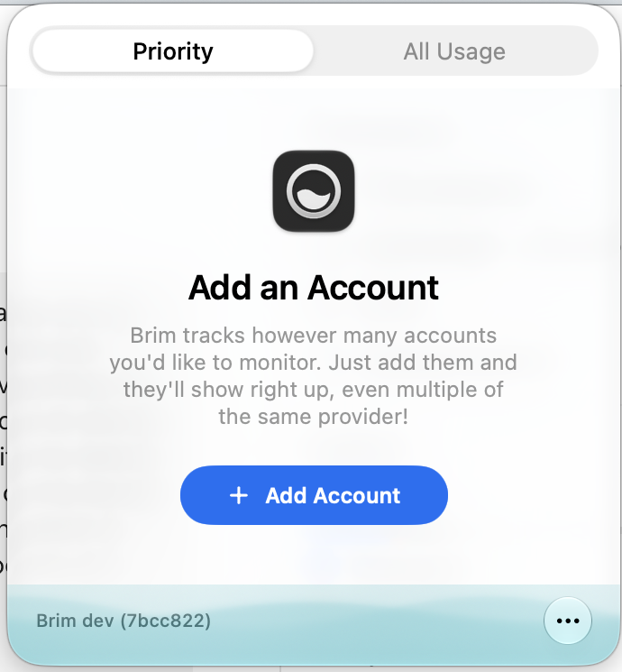

# Brim

A native macOS menu-bar app for your AI usage limits, in Liquid Glass.

> **Brim is an unofficial fork of [OpenUsage](https://github.com/robinebers/openusage) by Robin Ebers.** Nearly all of the app, its providers and its architecture come from that project. Brim isn't affiliated with or endorsed by OpenUsage. As [its trademark policy](TRADEMARK.md) requires, this fork has its own name and logo. Internal Swift modules keep the `OpenUsage` name so upstream changes stay easy to merge.



## What Brim changes

- **Liquid Glass throughout.** Requires macOS 26 or later.
- **Backgrounds.** Liquid Fill (rises with your most-used limit), Aurora, Sunset or None, in Settings > General.
- **Your refresh interval.** 1 minute to 1 hour, in Settings > General.
- **Fewer blocked Claude refreshes.** See below.
- **No analytics and no auto-updates.** Brim sends nothing to the original project. Update by rebuilding.
- **[Raycast extension](raycast/).** Your limits from the keyboard.

## Claude refreshes

Anthropic allows about 30 usage requests an hour per account, shared with Claude Code and any other monitor. Brim stays under that rather than around it:

- Refresh sends one request instead of three.
- Requests are at least a minute apart when you press Refresh, 5 minutes on a schedule, and capped at 20 an hour. A press inside those limits keeps the last reading.
- If Anthropic still pauses checks, Brim keeps showing the last reading and when it will check next.

**Claude Code Live Feed** (Settings > General) goes further: it adds a status line to Claude Code that saves your 5-hour and weekly limits to `~/.brim/claude-feed.json`, with no request to Anthropic. It updates while Claude Code is active, and the API is then read about every 30 minutes for the other rows. Use it with one Claude login in Brim, the same one Claude Code uses. It won't replace a status line you already have, and it backs up `settings.json` to `settings.json.brim-backup` first.

## Building

```sh
swift build
script/test_quiet.sh
./script/build_and_run.sh
```

The app is staged at `dist/Brim.app`. See [docs/](docs/) for behavior and architecture.

## License

[MIT](LICENSE), keeping the original copyright of Robin Ebers. The OpenUsage name and logo aren't covered; see [TRADEMARK.md](TRADEMARK.md).
